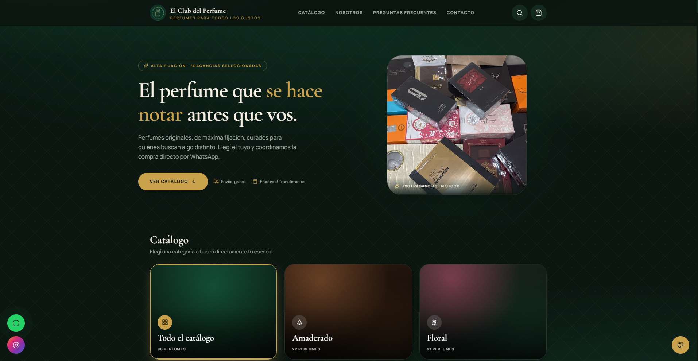
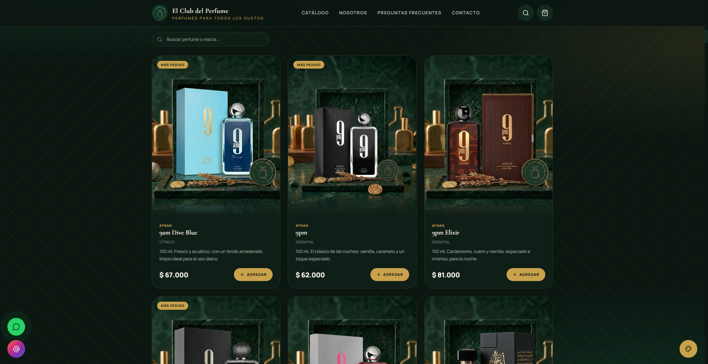
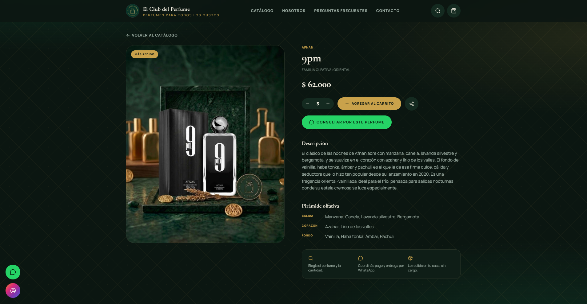
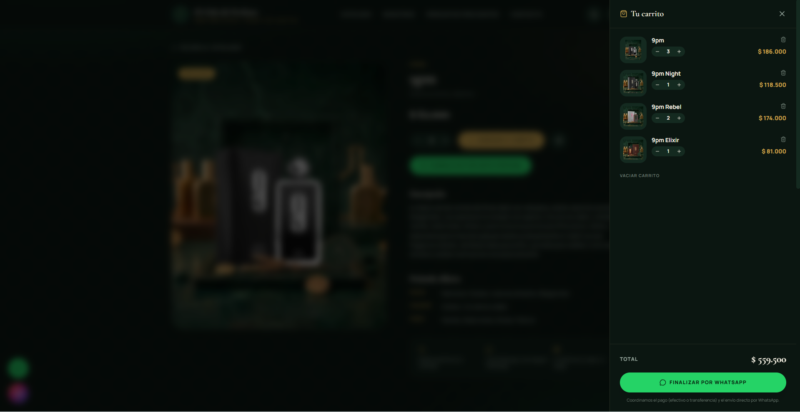
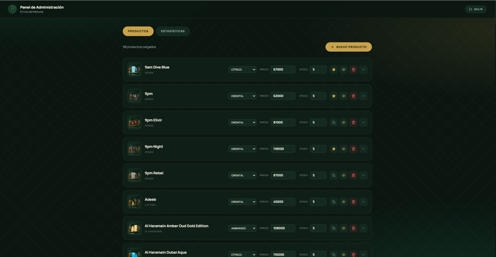

# Catálogo web de perfumes

Tienda online con **pedidos por WhatsApp** y un **panel de administración** para gestionar productos y stock.

> Este repositorio es una **vitrina**: muestra qué hace el sistema y cómo está armado. El código fuente es privado.
> **¿Querés un catálogo así para tu negocio?** [Escribime por mail](mailto:juan.avedano.contact@gmail.com?subject=Quiero%20un%20cat%C3%A1logo%20web%20como%20el%20de%20perfumes).

## Qué resuelve

El cliente arma su pedido en un carrito y lo envía por WhatsApp con un clic. El dueño actualiza productos, precios y stock desde un panel, sin tocar código.

## Funcionalidades

**Tienda**
- Catálogo con búsqueda y filtros por familia olfativa y ocasión.
- Ficha de producto con descripción y pirámide olfativa.
- Carrito y **pedido directo por WhatsApp**.

**Panel de administración** (autenticación JWT)
- Alta, edición y baja de productos.
- Precios y stock editables en línea.
- Productos destacados ("Más pedido").

## Capturas

| Inicio | Catálogo |
|---|---|
|  |  |

| Detalle del producto | Carrito y pedido por WhatsApp |
|---|---|
|  |  |

## Stack

**Backend:** FastAPI · SQLAlchemy
**Frontend:** React 19 · TypeScript · Vite · Tailwind CSS
**Autenticación:** JWT

## Contacto

**Juan Cruz Avedano** — Backend Developer (Python · FastAPI · React & TypeScript)
Córdoba, Argentina · [LinkedIn](https://www.linkedin.com/in/juan-cruz-avedano-165b90239/) · juan.avedano.contact@gmail.com
